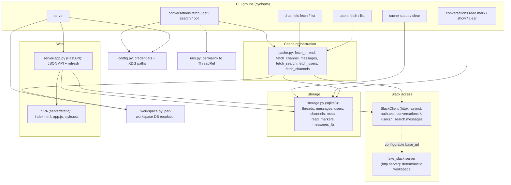
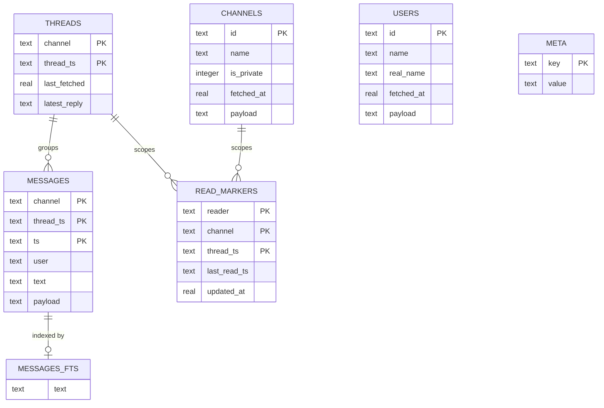
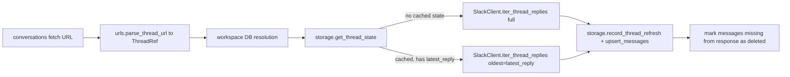
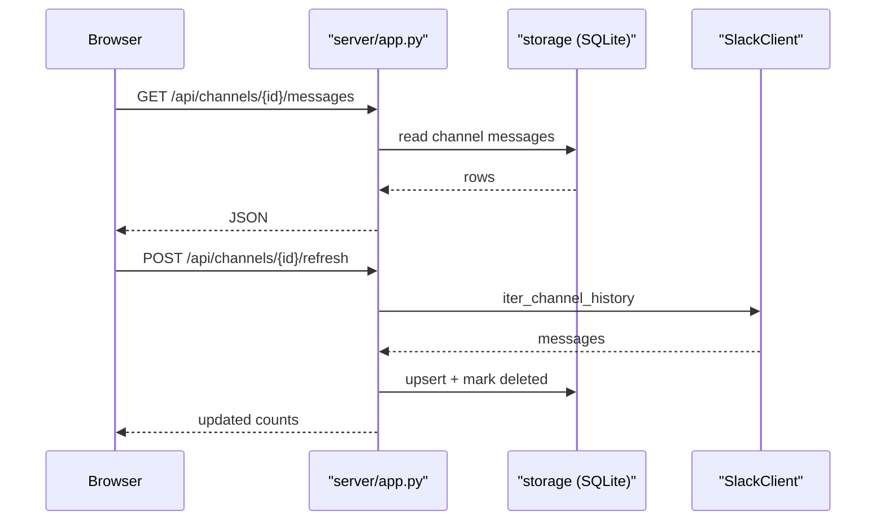

<!-- session_link: http://localhost:10000/?session=ses_ecd146300ffene4fNEdCg3uMTJ -->
# Architecture

## System Overview

slackx (package `slackx`) is a single-user Python 3.13 tool with two entry points: a cyclopts CLI and a FastAPI web server.
The CLI talks to a cache orchestration layer, which calls an async Slack client and writes to a per-workspace SQLite database through a synchronous storage layer.
A standalone fake Slack server provides deterministic data for tests and local development.

## Entity Relationship Diagram

The cache is a single SQLite database per workspace.
The diagram shows the core entities and their relationships; the full typed schema (columns, constraints, indexes) lives in `schema.dbml`.

A thread is identified by `(channel, thread_ts)` and owns one or more messages, keyed by `(channel, thread_ts, ts)`.
The `messages.thread_ts` column references `threads(thread_ts)` and `messages.channel` references `threads(channel)` (the FK is declared in the schema, not enforced by SQLite by default).
A read marker is keyed by `(reader, channel, thread_ts)` and points at a channel or a thread by those ids; `thread_ts` is the empty string for a channel-level pointer.
`messages_fts` is an external-content FTS5 table over `messages.text`, kept in sync by insert, delete, and update triggers, and is absent when the SQLite build lacks FTS5.
`users` and `channels` are standalone; they are joined to messages only by convention (the `user` field and the `channel` prefix), not by foreign keys.

## Key Components

| Component | Responsibility | Technology |
|---|---|---|
| CLI | Command groups (`conversations`, `channels`, `users`, `cache`, `serve`) and the `conversations read` subgroup, argument parsing, rendering | cyclopts, structlog |
| Cache orchestration | Full and incremental thread fetch, channel message fetch, search caching, user/channel fetch, result dataclasses | asyncio, dataclasses, structlog |
| `SlackClient` | Slack Web API calls with cursor and page pagination, `Retry-After` backoff, proactive rate-limit throttling, configurable base URL | httpx (async), structlog |
| `storage` | SQLite schema, upsert and query operations, incremental state, deleted-message marking, FTS5 search, read markers, status and clear, per-query SQL timing | sqlite3, structlog |
| `config` | Credential resolution (env then config file), XDG config and cache paths, API base URL override | python-dotenv, os |
| `urls` | Slack permalink parsing into `ThreadRef`, channel URL parsing, channel and ts validation | urllib.parse, dataclasses |
| `workspace` | Per-workspace database resolution via `auth.test`, name cache keyed by hashed credentials, last-used pointer, offline fallback | pathlib, hashlib, structlog |
| `server/app` | FastAPI JSON API (summary, users, channels, messages, threads, search, read markers) and refresh endpoints, plus SPA serving | FastAPI, uvicorn, pydantic |
| `fake_slack` | Deterministic in-process fake Slack API server with seeded workspace generation and per-endpoint rate limiting | http.server, random, structlog |
| Web SPA | Static browser UI for browsing channels, messages, and threads, with search and refresh, served under `/` and `/archives/...` | HTML, JavaScript, CSS (server/static) |

## Data Flow

Slack network calls are async and run on one event loop, while SQLite writes stay synchronous inside that loop.

### Thread fetch (incremental refresh)

`slackx conversations fetch <url>` parses the permalink into a `ThreadRef` and resolves the workspace database.
`cache.fetch_thread` reads `storage.get_thread_state` and decides full versus incremental: when the thread is already cached it passes `oldest=latest_reply` to `SlackClient.iter_thread_replies` so only new replies come back.
It then calls `storage.record_thread_refresh` and `storage.upsert_messages`, and marks any cached messages missing from the response as deleted instead of deleting them.

### Thread get

`slackx conversations get <url>` reads `storage.load_thread_messages` and `storage.load_user_display_names` and renders to stdout.
It auto-fetches when the thread is not cached, and `--no-fetch` keeps the command network-free.
Output is human-readable by default and JSON with `--json`.

### Channel message fetch

`slackx conversations fetch --channel <id>` (or a channel URL) calls `SlackClient.iter_channel_history` for top-level messages and writes each with `record_thread_refresh` plus `upsert_messages`.
With `--full-threads` it also calls `iter_thread_replies` for every threaded message and caches the replies.
`storage.mark_channel_roots_deleted_not_in` marks roots that disappeared from the channel.

### Search fetch and cache

`slackx conversations search <query>` calls `SlackClient.iter_search_messages` (`search.messages`) and caches each match.
A search match's thread root is resolved from the explicit `thread_ts`, then the match `permalink`, then the message's own `ts`, so a reply is filed under its true root and a later `get` is a cache hit.

### Poll loop

`slackx conversations poll` resolves a comma-separated channel list against the cached channels and loops on an interval.
Each cycle fetches channel history with a lookback window (`--last`, from `_duration._oldest_ts_from_last`), runs channels concurrently behind a semaphore, and optionally follows full threads.
Per-cycle summaries are printed, or emitted as JSON with `--json`.

### User and channel fetch

`slackx users fetch` and `slackx channels fetch` page through `users.list` and `conversations.list` via cursor pagination and write results with `storage.upsert_users` and `storage.upsert_channels`.
`users list` and `channels list` read the cache back and render.

### Read markers

`slackx conversations read mark` writes a last-read pointer with `storage.set_last_read`.
`slackx conversations read show` reads it back with `storage.get_last_read` or `storage.load_read_markers`.
`slackx conversations read clear` removes one or more pointers with `storage.delete_read_marker` and `storage.delete_read_markers`.
`slackx conversations get` also advances the pointer for the shown channel or thread after printing, so showing a conversation counts as reading it.
The `read` group lives under `conversations`, next to the `get` command that advances the same pointers.
Each pointer is owned by a reader (a consumer, for example `web`), so several consumers can track the same channel independently.

### Web API read path

`slackx serve` builds the FastAPI app via `create_app(db_path, api_base_url)` and serves it with uvicorn.
Read endpoints (`/api/summary`, `/api/users`, `/api/channels`, `/api/channels/{id}/messages`, `/api/channels/{id}/threads/{ts}`, `/api/search`, `GET /api/read`) query SQLite directly through a per-request connection.
`PUT /api/read` and the `DELETE /api/read/...` routes write and remove read markers.
The SPA at `server/static` is served at `/`, `/archives/{channel_id}`, and `/archives/{channel_id}/{message_ref}`, with assets mounted at `/static`.

### Web API refresh path

POST refresh routes (`/api/users/refresh`, `/api/channels/refresh`, `/api/channels/{id}/refresh`, `/api/channels/{id}/threads/{ts}/refresh`) build a `SlackClient` lazily from configured credentials and the app's API base URL.
They run the matching cache fetch function and return the updated counts; without credentials they fail with HTTP 503.

## Infrastructure

slackx is a local, single-user desktop tool; it runs in the user's process with no hosted service and no container.
The package is built with uv (uv_build backend) and installed as two console scripts: `slackx` (CLI and `serve`) and `slack-fake-server` (fake Slack API).
State lives under the XDG directories: the config file at `~/.config/slackx/config`, credentials in `SLACK_TOKEN` and `SLACK_COOKIE`, and one SQLite database per workspace at `~/.cache/slackx/<workspace>/threads.db`.
The web UI binds to `127.0.0.1:8280` by default and is intended for local use only.
Detailed tooling, CI pipelines, environments, and deployment procedures live in `infrastructure.md`.
Monitoring, logging, and alerting live in `observability.md`.

## Architecture Decisions

- SQLite is the local cache store: zero-config, single-file, and upsert-friendly via `INSERT OR REPLACE`.
- The full Slack message JSON is kept in a `payload` column next to extracted fields (`ts`, `user`, `text`), so queries stay fast and rendering never re-parses the JSON.
- FTS5 is a separate, optional schema (`SEARCH_SCHEMA`); when the SQLite build lacks FTS5 the tool still caches and browses, and search degrades to no results.
- Network calls are async (`httpx`) while SQLite access stays synchronous `sqlite3`, because the writes are fast and run on a single event loop.
- `SlackClient` is imported lazily in the CLI and the server, so network-free commands (`get --no-fetch`, `users list`) never import httpx.
- Module-level loggers come from `slackx._log.get_logger`, which imports structlog on first use; structlog (and the asyncio, stdlib logging, and rich modules it pulls in) is therefore absent from the `--help` path.
- CLI defaults that the API client also owns (for example `DEFAULT_SEARCH_LIMIT`) live in `defaults.py`, so using one as a command default does not import httpx.
- Help renders with cyclopts' `plaintext` format: the `markdown` default imports `rich.markdown` and pygments on every `--help` (tens of milliseconds) to format text that contains no markdown. Sub-apps inherit the setting through the app stack, and tests fail if a backtick reaches the rendered help.
- Frozen dataclasses model immutable values (`ThreadRef`, `Credentials`, `ThreadState`, `CachedMessage`, `CachedUser`, `CachedChannel`, `FetchResult`).
- `SlackClient` takes a configurable `base_url`, so the fake server can stand in for Slack without code changes.
- The fake Slack server is deterministic: a seeded RNG generates users, channels, and threads, and per-endpoint rate limiting is reproducible.
- Deleted messages are marked as deleted rather than removed, so cache reads and read markers keep stable references.
- One SQLite database per workspace prevents channel and user id collisions between workspaces.
- Workspace identity comes from `auth.test` (URL subdomain preferred, team id fallback), so every command resolves the workspace the same way.
- The token-to-workspace mapping is cached on disk under a hashed key, so `auth.test` runs once per credential set and no secret is stored.
- A last-used workspace pointer lets read-only commands resolve their database offline.
- The legacy single `threads.db` is never migrated; it stays in place and only serves offline fallback reads.
