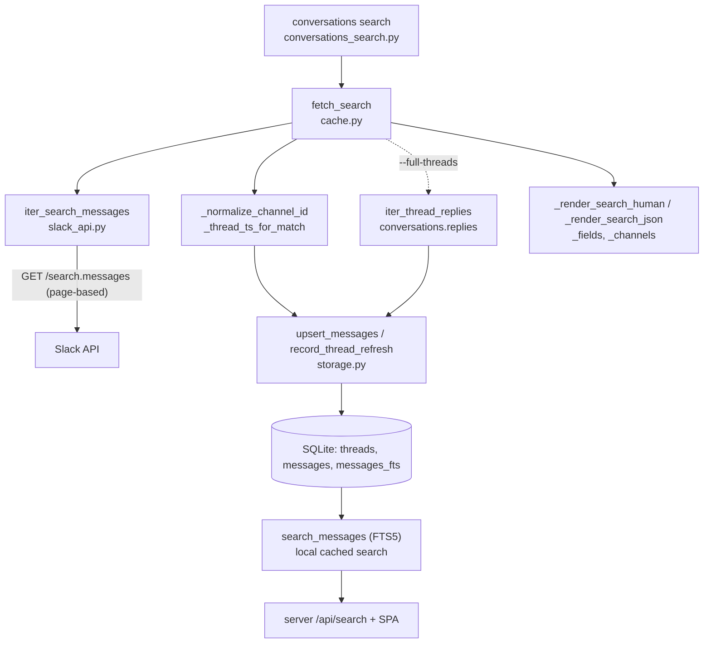
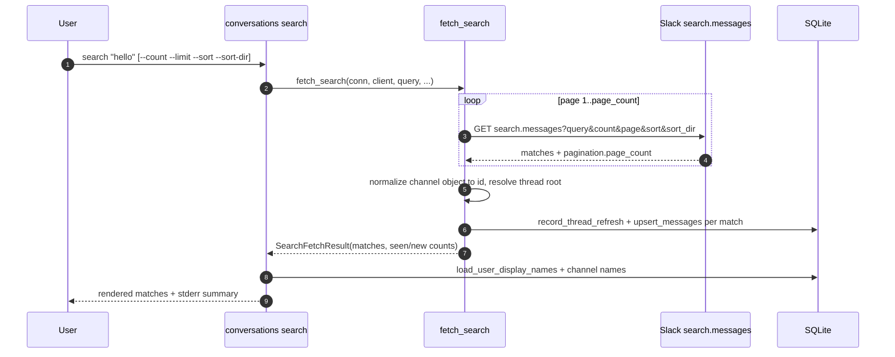
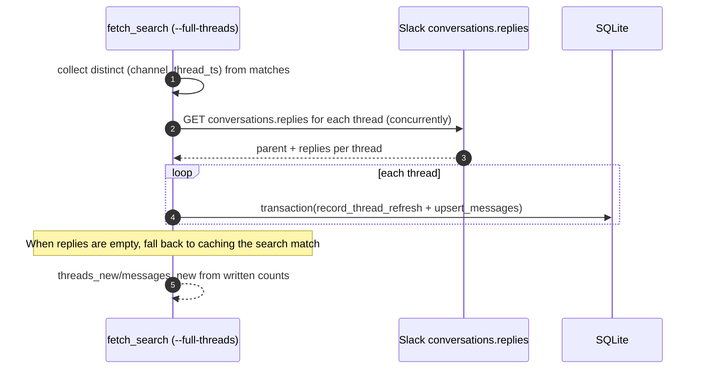

# Specification: Conversation Search

## Overview

The `conversations search` command runs a Slack search query, pages through `search.messages`, normalizes each match, caches it under its thread, and renders the matches.
Orchestration lives in `fetch_search` (`cache.py`), the HTTP call in `iter_search_messages` (`slack_api.py`), persistence in `upsert_messages` and `record_thread_refresh` (`storage.py`), and the command in `conversations_search.py`.
The local full-text index (`messages_fts`) and `storage.search_messages` provide the separate cached-message search that the web UI exposes.
This document records already implemented behavior, reverse-engineered during `/sync-sdlc`.

## Architecture

## Data Models

### SearchFetchResult

A frozen dataclass returned by `fetch_search`, summarizing one search run.

| Field | Type | Constraints | Description |
|---|---|---|---|
| query | str | not null | The search query as entered |
| matches | list[dict] | not null | The raw normalized matches, so the caller can render without re-reading the cache |
| threads_seen | int | not null | Every distinct thread touched on this run |
| threads_new | int | not null | The subset of threads that received at least one new or modified message |
| messages_seen | int | not null | Every message passed to the cache (matches, or matches plus replies with `--full-threads`) |
| messages_new | int | not null | The subset of those messages actually written |

### SearchHit

A frozen dataclass returned by `storage.search_messages`, describing one cached message matched by the local full-text index.

| Field | Type | Constraints | Description |
|---|---|---|---|
| channel | str | not null | Channel id |
| thread_ts | str | not null | Thread root ts |
| ts | str | not null | Message ts |
| user | str or None | nullable | Author user id when present |
| text | str or None | nullable | Message text |
| snippet | str or None | nullable | FTS5 `snippet()` of the matched text, with `[` `]` delimiters |

The `matches` list carries raw Slack match dicts; the fields this feature relies on are `channel` (object or id), `ts`, `thread_ts`, `user`, `text`, and `permalink`.

## API Contracts

This feature has no HTTP API of its own.
On the outbound side it calls the external Slack `search.messages` endpoint with `query`, `count`, `page`, `sort`, and `sort_dir` parameters, and (with `--full-threads`) `conversations.replies` with `channel` and `thread_ts`.
Neither endpoint is owned by this project, so no `api.yaml` is written here.
On the inbound side the only interface is the local Python call `storage.search_messages(conn, query, limit)`, used by the web UI's `/api/search` route, not by the CLI search command.

## Sequences

### Search, page, and cache

### Full-thread expansion

## Technical Decisions

| Decision | Choice | Rationale |
|---|---|---|
| Pagination style | Page-based (`page` N of `page_count`), not cursor | `search.messages` reports `page_count`, unlike the cursor-based list endpoints |
| Page loop guard | Track seen page numbers and stop on a repeat | A malformed response cannot loop forever |
| Channel normalization | Accept an object or a string and return a bare id | `search.messages` returns `channel` as an object where other endpoints use a plain id |
| Reply thread root | Prefer explicit `thread_ts`, then the permalink, then the message ts | Slack returns `thread_ts: null` for replies, so keying off the reply ts would make later `show` calls a cache miss |
| Full-thread caching | Skip direct match caching when `--full-threads` is set, and cache only through replies | Slack decorates the same message differently between the two endpoints, so caching both would oscillate |
| Match limit | Cap total matches with `--limit`, default 200 | Broad queries can span hundreds of pages and take a long time under rate limits |
| Concurrency | Fetch distinct thread replies with `asyncio.gather`, one transaction per thread | Keeps latency low and transactions small |
| Output | Human by default, JSON with `--json`, JSONL with `--jsonl`, field selection with `--fields` | Matches the conventions of the other list commands |
| Local search | FTS5 over `messages.text`, synced by triggers | Gives the web UI fast cached-message search; degrades when FTS5 is absent |

## Risks and Unknowns

1. Endpoint payload drift between `search.messages` and `conversations.replies` can inflate new counts if Slack changes the decoration; `--log-level debug` prints `message_payload_diff` for investigation.
2. The FTS5 index is optional, so local search silently returns nothing on a SQLite build without FTS5.
3. Pagination correctness depends on Slack's reported `page_count`; if it is mutable between pages, the guard stops on a repeated page rather than finishing.

## Out of Scope

- The web UI search page and the `/api/search` HTTP route, covered by the Web UI feature.
- Polling and incremental channel refresh, covered by the Channel Polling and Channel Message Fetching features.
- Changes to the Slack `search.messages` or `conversations.replies` contracts, which are external.
