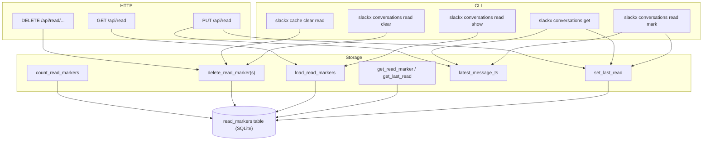
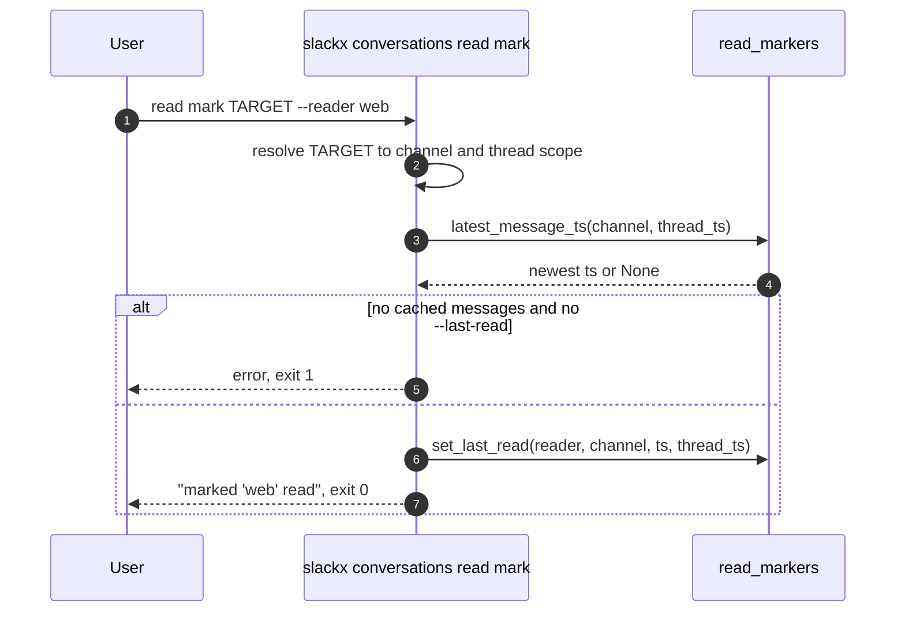
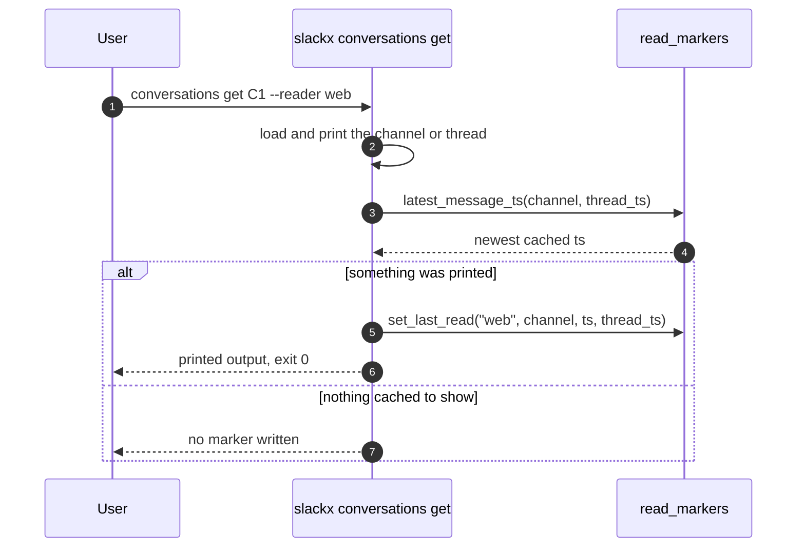
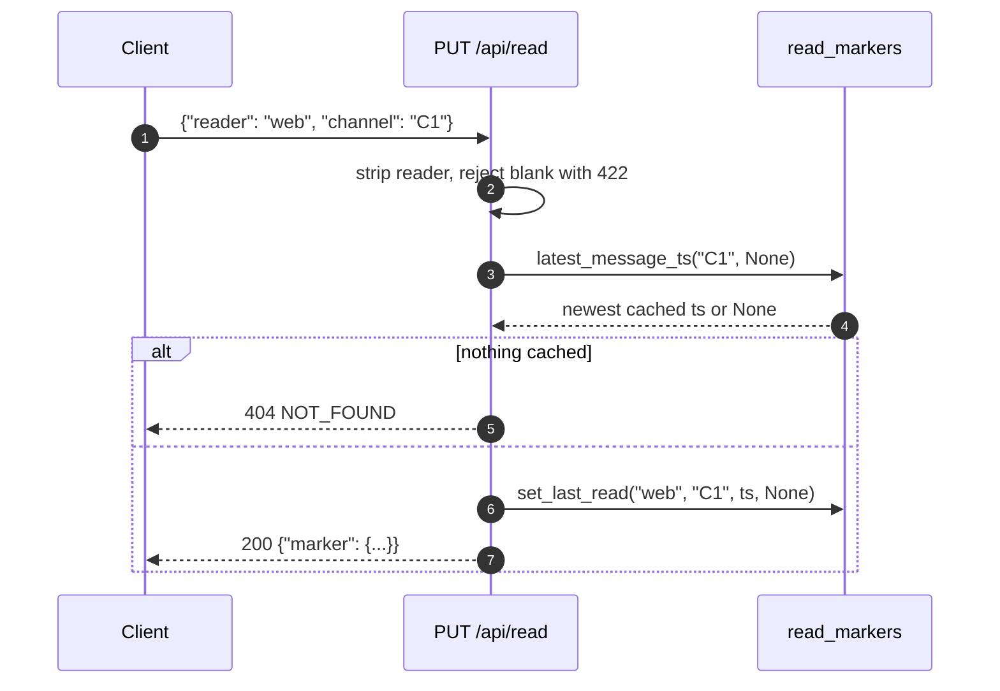
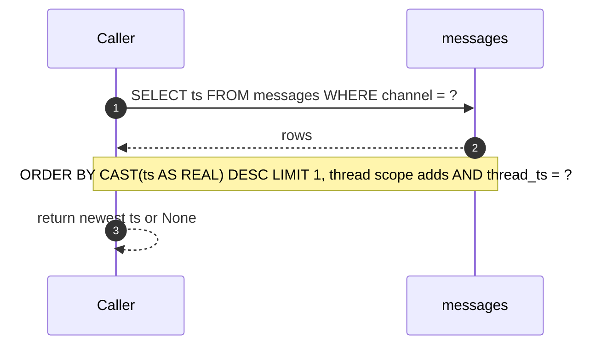

# Specification: Read markers (last-read tracking)

## Overview

Read markers record how far a named consumer has read in a channel or a thread.
A marker is a row in the `read_markers` table keyed by (reader, channel, thread_ts), where an empty thread_ts represents the channel-level pointer and a thread root ts represents that thread's pointer.
The `slackx conversations read` command group (mark, show, clear) and the `serve` HTTP API under `/api/read` are two front ends over the same storage functions.
`slackx conversations get` is a third: after printing a channel or thread it advances the same pointer for the chosen reader (default `default`).
Pointers are stored in the cache database, so they are per workspace and survive restarts.

## Architecture

## Data Models

### ReadMarker

| Field | Type | Constraints | Description |
|---|---|---|---|
| reader | str | required | Reader that owns the pointer |
| channel | str | required | Channel id the pointer applies to |
| thread_ts | str or None | nullable | Thread root ts, or None for the channel-level pointer |
| last_read_ts | str | required | Newest message timestamp the consumer has read in scope |
| updated_at | float | required | Unix epoch seconds when the row was last written |

### read_markers table

| Column | Type | Constraints | Description |
|---|---|---|---|
| reader | TEXT | NOT NULL, part of PK | Reader that owns the pointer |
| channel | TEXT | NOT NULL, part of PK | Channel id the pointer applies to |
| thread_ts | TEXT | NOT NULL, part of PK | Empty string for the channel-level pointer, otherwise a thread root ts |
| last_read_ts | TEXT | NOT NULL | Newest message timestamp the consumer has read in scope |
| updated_at | REAL | NOT NULL | Unix epoch seconds when the row was last written |

The primary key is (reader, channel, thread_ts), and the index `idx_read_markers_reader` covers (reader, channel).
`_marker_scope` maps a None thread ts to the empty-string sentinel on write and lookup, and `_row_to_read_marker` maps it back to None on read.
`latest_message_ts` returns the cached message with the largest ts for the scope, ordered by `CAST(ts AS REAL) DESC LIMIT 1`, and returns None when nothing is cached.
`set_last_read` writes with an `INSERT ... ON CONFLICT(reader, channel, thread_ts) DO UPDATE` so re-marking a scope updates the row in place.

## API Contracts

The HTTP surface is served by the FastAPI app in `server/app.py` under `/api/read`.
The table below is the full contract summary; the request body for PUT is the `ReadMarkerInput` model with fields reader (required), channel (required), thread_ts (optional), and last_read_ts (optional).
There is no separate `api.yaml` for this feature; this summary is the contract.

| Method | Path | Purpose |
|---|---|---|
| GET | /api/read | List pointers, optionally filtered by `reader` and `channel` query parameters |
| PUT | /api/read | Create or advance a pointer; `last_read_ts` defaults to the newest cached message in scope |
| DELETE | /api/read/{reader} | Delete all pointers for a reader, or only one channel's when `?channel=` is given |
| DELETE | /api/read/{reader}/{channel_id} | Delete the channel-level pointer, keeping the channel's thread pointers |
| DELETE | /api/read/{reader}/{channel_id}/{thread_ts} | Delete one thread pointer |

Response bodies:

| Method | Path | Success body |
|---|---|---|
| GET | /api/read | {"read_count": int, "markers": [ReadMarker, ...]} |
| PUT | /api/read | {"marker": ReadMarker} |
| DELETE | /api/read/{reader} | {"deleted": int} |
| DELETE | /api/read/{reader}/{channel_id} | {"deleted": int} |
| DELETE | /api/read/{reader}/{channel_id}/{thread_ts} | {"deleted": int} |

Error codes shared across endpoints:

| Status | Code | Description |
|---|---|---|
| 404 | NOT_FOUND | PUT found no cached messages in scope and no explicit last_read_ts was given |
| 422 | UNPROCESSABLE_ENTITY | PUT was given a blank reader after stripping whitespace |

## Sequences

### CLI mark with a default timestamp

### Show advancing the pointer

### API PUT with a default last_read_ts

### Resolving the newest cached timestamp

## Technical Decisions

| Decision | Choice | Rationale |
|---|---|---|
| Row scope key | Single table keyed by (reader, channel, thread_ts) | Lets a channel pointer and any number of thread pointers for the same reader and channel coexist |
| Channel-level sentinel | Empty string in thread_ts, mapped to None at the API | SQLite primary keys cannot hold NULL, so an empty string marks the channel-level pointer |
| Write semantics | INSERT ON CONFLICT DO UPDATE | Re-marking a scope updates the row instead of duplicating it |
| Default timestamp | newest cached message in scope | A consumer can mark a channel or thread read without knowing a ts |
| Show advances the pointer | `conversations get` sets the pointer after printing, keyed by its `--reader` (default `default`) | Showing a conversation to a consumer is reading it, so no separate mark call is needed |
| Transaction ownership | Callers wrap writes in `transaction(conn)` | Keeps the storage functions composable and free of implicit commits |
| HTTP error mapping | 404 for no cached messages, 422 for a blank reader | Matches the CLI error paths (exit 1 and exit 2 respectively) |
| Contract format | Summary table, no separate api.yaml | The surface is small and defined in `server/app.py`, so a table is enough |

## Risks and Unknowns

1. Timestamp ordering relies on `CAST(ts AS REAL)`, so a non-numeric ts would sort unexpectedly; Slack ts values are numeric strings.
2. The empty-string sentinel could collide with a real thread root ts, though Slack thread ts values are never empty.
3. Readers are free-form with no length or character validation beyond the non-empty check.
4. The HTTP API has no authentication, so any client that can reach `serve` can read and write pointers.

## Out of Scope

- Auto-advancing a pointer on fetch or search; only `slackx conversations get` and explicit `slackx conversations read mark` move pointers.
- Syncing pointers across workspaces or machines, they stay in the per-workspace cache database.
- Multi-user permissions or sharing of readers between users.
- A separate OpenAPI document for the read endpoints.
