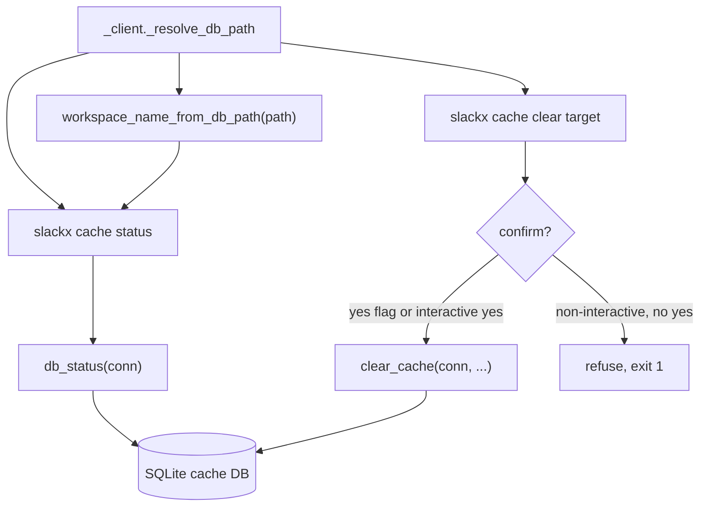
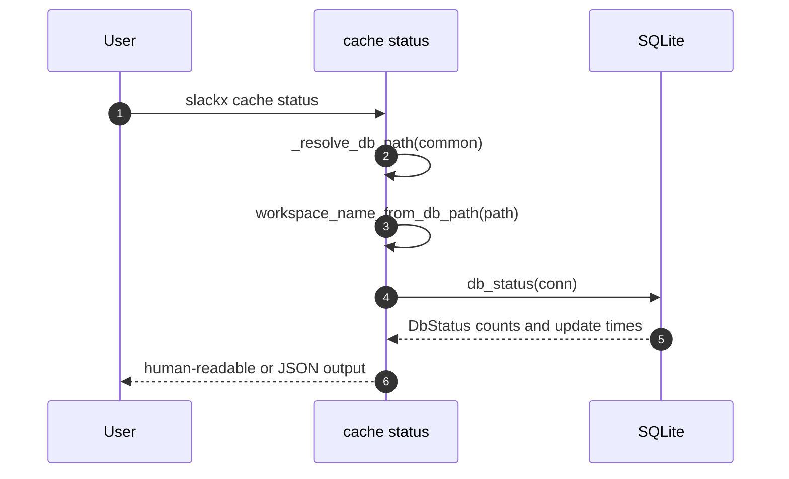
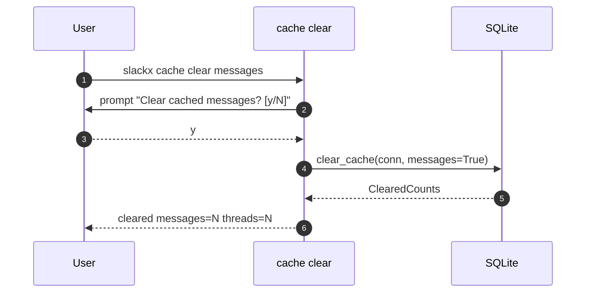
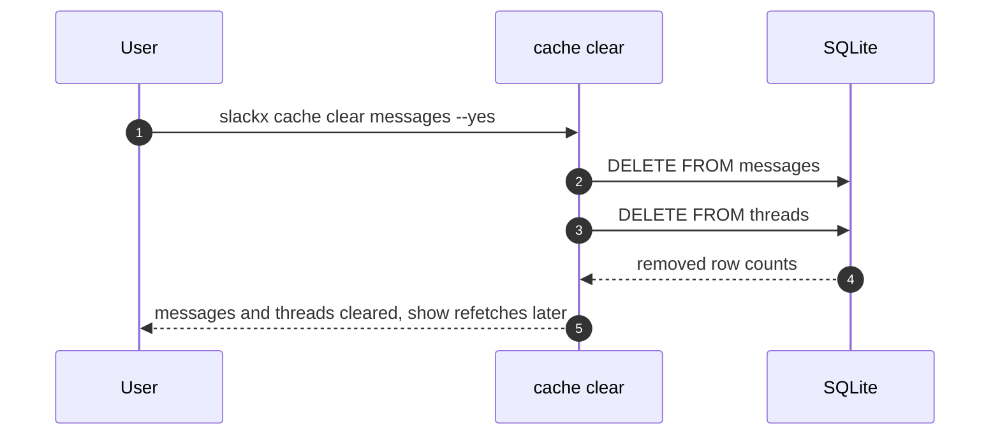

# Specification: Cache Management

## Overview

The cache management feature is a thin CLI surface over the SQLite storage helpers.
The `cache status` command reads aggregate counts and last update times from the database, alongside the resolved workspace name and database path, and renders them.
The `cache clear` command deletes rows for a chosen entity after a confirmation.
Both commands resolve the database connection through the shared client helper and never touch the network.

## Architecture

## Data Models

### DbStatus

Aggregate counts and last-update times returned by `db_status`.

| Field | Type | Constraints | Description |
|---|---|---|---|
| channel_count | int | not null | number of cached channels |
| user_count | int | not null | number of cached users |
| thread_count | int | not null | number of cached threads |
| message_count | int | not null | number of cached messages |
| channels_updated_at | float or none | nullable | newest channel fetched_at, none when the table is empty |
| users_updated_at | float or none | nullable | newest user fetched_at, none when the table is empty |
| threads_updated_at | float or none | nullable | newest thread last_fetched, none when the table is empty |
| read_marker_count | int | not null, defaults to 0 | number of stored read markers |

### ClearedCounts

Number of rows removed by `clear_cache`, per entity.

| Field | Type | Constraints | Description |
|---|---|---|---|
| messages | int | not null | rows removed from messages |
| threads | int | not null | rows removed from threads |
| channels | int | not null | rows removed from channels |
| users | int | not null | rows removed from users |
| read_markers | int | not null, defaults to 0 | rows removed from read_markers |

### StatusOutput

The status command reports the database resolved for the invocation, in addition
to the `DbStatus` counts and update times.

| Field | Type | Constraints | Description |
|---|---|---|---|
| workspace | string or none | nullable | resolved workspace name, none for a custom `--db` or the legacy single `threads.db` |
| db_path | string | not null | absolute path of the cache database that was opened |
| channel_count ... read_marker_count | (see DbStatus) | not null | the `DbStatus` fields, spread into the same object |

The JSON renderer emits `workspace`, `db_path`, then the `DbStatus` fields; the
human renderer prints `Workspace:` (when known) and `Database:` lines above the
counts.

## API Contracts

There is no HTTP API.
This feature is CLI only, so no OpenAPI `api.yaml` is produced.
The command surface is `slackx cache status` with the `--json` and `--jsonl` output options, and `slackx cache clear [all|messages|channels|users|read]` with the `--yes` (or `-y`) option.

## Sequences

### Status report

### Clear with confirmation

### Clearing messages also drops thread metadata

## Technical Decisions

| Decision | Choice | Rationale |
|---|---|---|
| Command grouping | `cache status` and `cache clear` are separate commands under the `cache` group | Keeps read-only inspection separate from destructive clearing |
| Clear target | A single positional target of `all`, `messages`, `channels`, `users`, or `read` | One command covers every clearing scope without extra flags |
| Thread cleanup | Clearing messages also deletes the threads table | Thread rows signal that a thread is cached, so leaving them would suppress a refetch |
| Confirmation | Interactive prompt on a terminal, `--yes` or `-y` to skip, refuse on a non-tty | Prevents accidental deletion while allowing scripts to run unattended |
| Status output | Human-readable by default with `--json` and `--jsonl` alternatives | Matches the output convention of the other CLI commands |
| Workspace in status | Derived from the resolved database path (`workspace_name_from_db_path`), not re-resolved from credentials | Reports the workspace actually in use, including for `--workspace` and offline resolution, with no extra `auth.test` call |

## Risks and Unknowns

1. The clear command is destructive and cannot be undone, so the confirmation path must stay reliable.
2. A non-interactive run without `--yes` refuses rather than deleting, which is safe but can surprise a script author until they add the flag.
3. Clearing read markers removes another consumer's pointers, so a user can lose their own last-read position without intending to.

## Out of Scope

- Deleting individual cached threads or messages by id.
- Undoing or restoring a cleared cache.
- Backing up the cache before clearing.
- Clearing data through the web UI.
