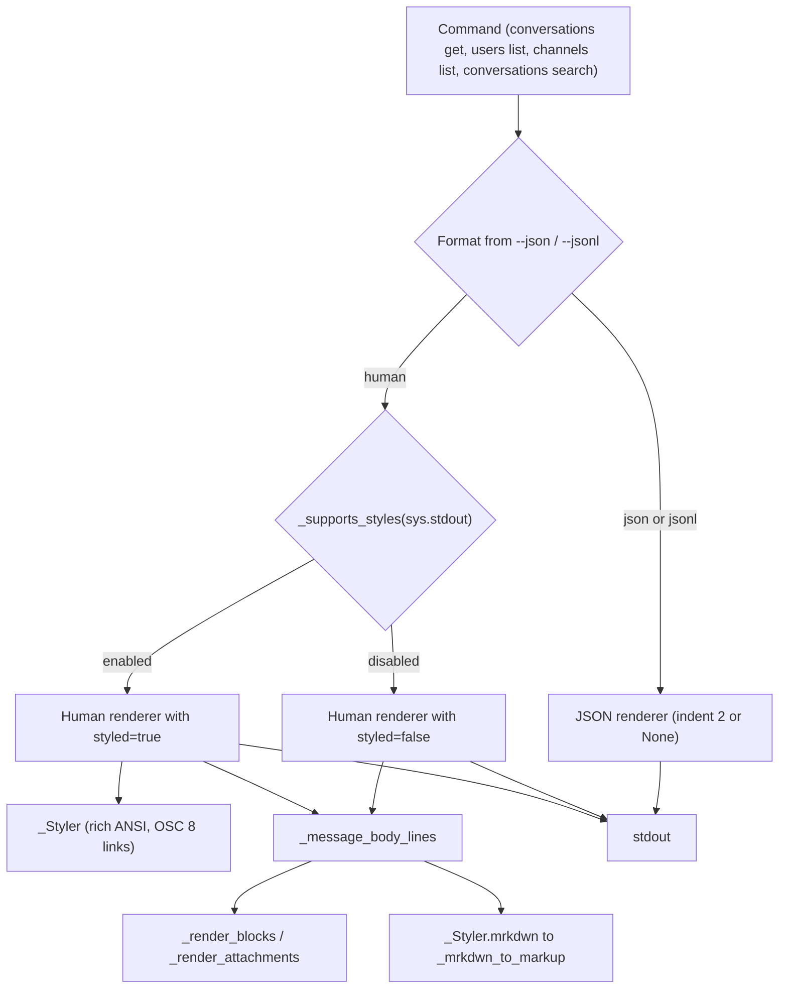
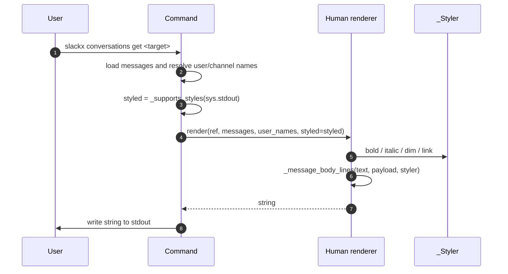
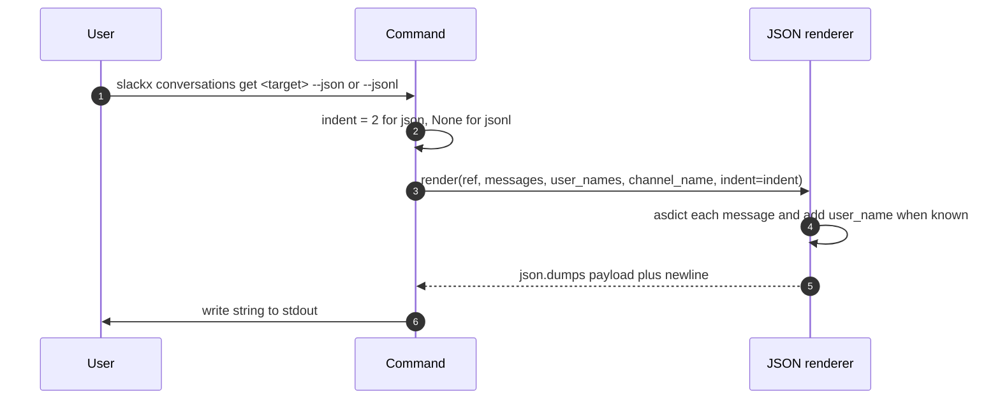
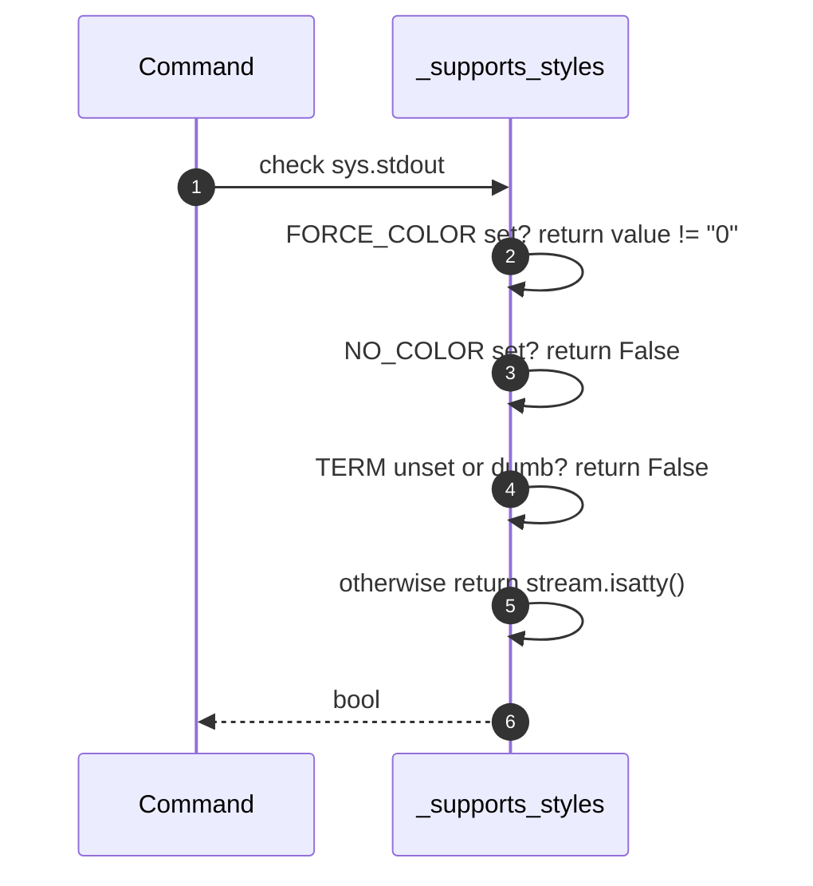

# Specification: Message rendering

## Overview

The CLI renders already-loaded cached data into strings on stdout.
Each command loads its records, picks a format from `--json` and `--jsonl`, and calls a human or JSON renderer in `cli/_internal/_render.py`.
Human renderers take a `styled` flag computed from `_supports_styles(sys.stdout)`.
Styling wraps headers, authors, timestamps, and permalinks with `rich` styles and routes message text through the mrkdwn converter.
Blocks and attachments are assembled by `_blocks.py`, and timestamps and field selection come from `_format.py` and `_fields.py`.
No renderer reads the database, the network, or argument parsing state.

## Architecture

## Data Models

Rendered output models are assembled in memory per call.
Nothing is persisted by this feature, the SQLite cache is the storage layer and rendering only reads its records.

### ThreadOutput

| Field | Type | Constraints | Description |
|---|---|---|---|
| channel | str | not null | Slack channel id |
| channel_name | str or null | nullable | Resolved channel display name |
| thread_ts | str | not null | Thread root timestamp |
| message_count | int | not null | Number of messages |
| messages | list of MessageOutput | not null | Enriched message records |

### MessageOutput

| Field | Type | Constraints | Description |
|---|---|---|---|
| ts | str | not null | Message timestamp from `CachedMessage` |
| user | str or null | nullable | Author user id |
| text | str or null | nullable | Extracted message text |
| payload | dict | not null | Full Slack message JSON |
| user_name | str | present only when the author is cached | Resolved author display name |

### ChannelOutput

| Field | Type | Constraints | Description |
|---|---|---|---|
| channel | str | not null | Slack channel id |
| channel_name | str or null | nullable | Resolved channel display name |
| message_count | int | not null | Number of messages |
| messages | list of ChannelMessageOutput | not null | Message records with thread info |

### ChannelMessageOutput

| Field | Type | Constraints | Description |
|---|---|---|---|
| ts | str | not null | Message timestamp |
| user | str or null | nullable | Author user id |
| text | str or null | nullable | Extracted message text |
| thread_ts | str | not null | Thread root ts, equal to ts for a top-level message |
| is_thread_reply | bool | not null | True when thread_ts differs from ts |
| user_name | str | present only when the author is cached | Resolved author display name |

### List output

| Field | Type | Constraints | Description |
|---|---|---|---|
| user_count / channel_count / match_count | int | not null | Number of records in the payload |
| users / channels / matches | list of dict | not null | One dict per record with the selected fields |

## API Contracts

No HTTP or programmatic API is exposed by this feature.
The interface is CLI output on stdout, summarized below.

| Command | Output | Format selection |
|---|---|---|
| conversations get (thread) | ThreadOutput | `--json` pretty, `--jsonl` compact |
| conversations get (channel) | ChannelOutput | `--json` pretty, `--jsonl` compact |
| conversations search | search payload | `--json` pretty, `--jsonl` compact |
| users list | users payload | `--json` pretty, `--jsonl` compact |
| channels list | channels payload | `--json` pretty, `--jsonl` compact |

Error output:

| Exit code | Condition |
|---|---|
| 2 | `--json` combined with `--jsonl`, or an unknown `--fields` value |

## Sequences

### Human-readable path

### JSON and JSONL path

### Style detection

## Technical Decisions

| Decision | Choice | Rationale |
|---|---|---|
| Styling library | `rich` | Handles ANSI codes and OSC 8 hyperlinks and is already a dependency |
| mrkdwn handling | Custom regex parser in `_mrkdwn.py` | Slack mrkdwn differs from markdown, a general parser would not match Slack |
| Piped output | Plain text when not a TTY | Keeps bytes stable for scripts and avoids escape codes in files |
| Renderer design | Pure functions returning strings | Easy to test without a database or terminal |
| Blocks vs text | Blocks first, text fallback, attachments appended | Bot messages carry links in blocks or attachments, matching the web UI order |
| JSON encoding | `ensure_ascii=False` with a trailing newline | Preserves non-ASCII text and keeps output parseable line by line |

## Risks and Unknowns

1. Slack may introduce new block types that the current block renderer skips.
2. The mrkdwn parser is line-local, so a construct split across lines is not converted.
3. Styled output is not covered by an end-to-end terminal capture, so styled rendering relies on unit tests.

## Out of Scope

- Fetching or storing messages, which belongs to the caching features.
- The FastAPI web UI and its JSON API.
- Styling behavior of third-party terminal emulators.
- Rich text beyond the supported Slack block types.
