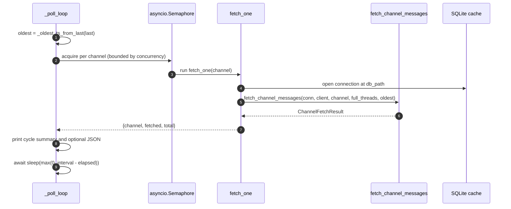
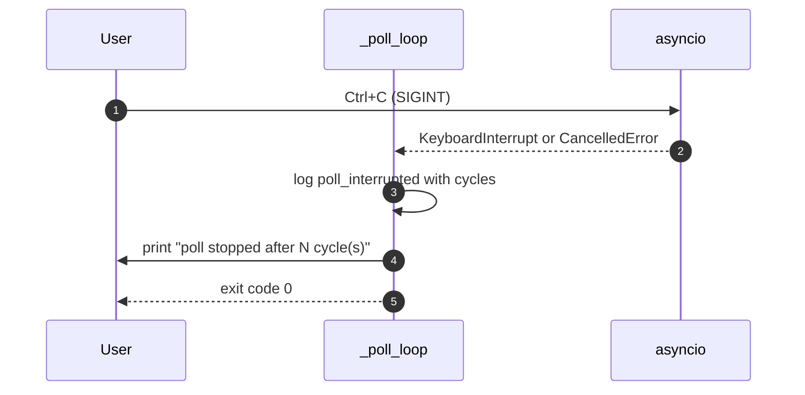

# Specification: Channel Polling

## Overview

Channel polling is delivered by the `conversations poll` command, which resolves the requested channels and then enters an async loop in `_poll_loop`.
Each cycle computes an `oldest` timestamp from `--last`, fetches every channel concurrently under an `asyncio.Semaphore`, writes the messages through `fetch_channel_messages`, prints a cycle summary, and sleeps until the interval has elapsed.
The loop reuses one `httpx.AsyncClient` and a shared `RateLimitState` so concurrent fetches coordinate their throttling.
The loop ends when `Ctrl+C` raises `KeyboardInterrupt` or when asyncio cancels it.

## Architecture

```mermaid
flowchart TD
    CLI["conversations poll command"] -->|parse args| RESOLVE["_resolve_poll_channels"]
    RESOLVE -->|channel ids| LOOP["_poll_loop"]
    LOOP -->|each cycle| OLDEST["_oldest_ts_from_last(last)"]
    LOOP -->|asyncio.Semaphore(concurrency)| FETCH["fetch_one(channel)"]
    FETCH --> OPEN["_open_db_at(db_path)"]
    FETCH --> FCM["fetch_channel_messages(conn, client, channel, full_threads, oldest)"]
    FCM --> STORE["SQLite cache (threads + messages)"]
    STORE --> SUMMARY["stderr summary + optional --json payload"]
    LOOP -->|shared| CLIENT["httpx.AsyncClient + RateLimitState"]
    CLIENT --> FCM
    SUMMARY --> SLEEP["asyncio.sleep(interval - elapsed)"]
    SLEEP --> LOOP
```

The command layer (`conversations_poll.py`) parses and validates input, resolves channels, and delegates to `_poll_loop`.
`_poll_loop` owns the async client, the semaphore, the cycle counter, and the shutdown handling.

## Data Models

The loop defines no new persisted entities.
It reuses `ChannelFetchResult` from `slack_cached.cache`, whose fields are `channel`, `fetched_messages`, `total_messages`, and `threads_with_replies_fetched`.
Each `fetch_one` call returns a plain per-channel summary dict derived from that result, either `{"channel", "fetched", "total"}` on success or `{"channel", "error": True}` on failure.
The `--json` payload is a plain dict with the keys `cycle`, `elapsed_seconds`, and `channels` (the list of per-channel summary dicts).

### RateLimitState

| Field | Type | Constraints | Description |
|---|---|---|---|
| remaining | int or None | private | Last seen `X-RateLimit-Remaining` value |
| reset_at | float or None | private | Epoch seconds of `X-RateLimit-Reset` |
| lock | asyncio.Lock | private | Serializes access across concurrent tasks |

`RateLimitState.update_from_headers` records the latest headers.
`should_slow_down` reports whether the bucket is nearly empty.
`wait_for_reset_if_needed` sleeps until `reset_at` when remaining is 2 or lower.

## API Contracts

None.
Channel polling is a CLI command backed by a long-lived async loop; it exposes no HTTP API surface and writes no `api.yaml`.

## Sequences

### One poll cycle



### Shutdown by Ctrl+C



## Technical Decisions

| Decision | Choice | Rationale |
|---|---|---|
| Concurrency model | `asyncio.Semaphore` plus `asyncio.gather` per cycle | Fetches many channels without a thread pool and bounds in-flight requests |
| Interval accounting | Sleep `max(0, interval - elapsed)` | Keeps the cadence close to the interval instead of interval plus work time |
| Rate limiting | Shared `RateLimitState` fed by `X-RateLimit-*` headers | Concurrent tasks coordinate and slow down before Slack returns 429 |
| Client lifetime | One `httpx.AsyncClient` for the whole run | Reuses connections and avoids per-cycle setup cost |
| Database access | `_open_db_at` per channel fetch inside the semaphore | Keeps each fetch's connection short-lived while sharing one resolved path |
| Error isolation | Catch `Exception` per channel in `fetch_one` | One bad channel does not abort the cycle (NFR-1) |
| Interval vs lookback | `--interval` rejects `all`, `--last` accepts it | A finite gap is required to poll, but a full-history lookback is valid |
| Shutdown | Catch `KeyboardInterrupt` and `CancelledError` | Both a signal and a programmatic cancel stop the loop the same way |

## Risks and Unknowns

1. A very small `--interval` with many channels can keep the loop busy continuously, since sleep floors at zero.
2. The loop has no backoff, so a channel that fails every cycle is retried at the full interval with no increasing delay.
3. Proactive throttling only helps once headers have been observed; the first request in a fresh bucket is not protected.
4. Long-running growth in the SQLite cache is not bounded by the loop; retention is out of its control.
5. There is no test that exercises the `Ctrl+C` path or the rate-limit wait directly.

## Out of Scope

- A run-once or `--max-cycles` mode.
- Per-channel intervals or per-channel lookbacks.
- Backoff or jitter between cycles.
- Updating read markers, notifications, or push-style delivery for new messages.
- Retention or pruning of the cache while polling.
