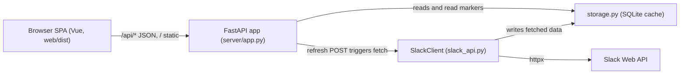
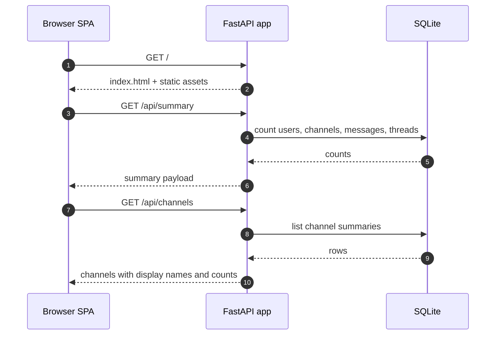
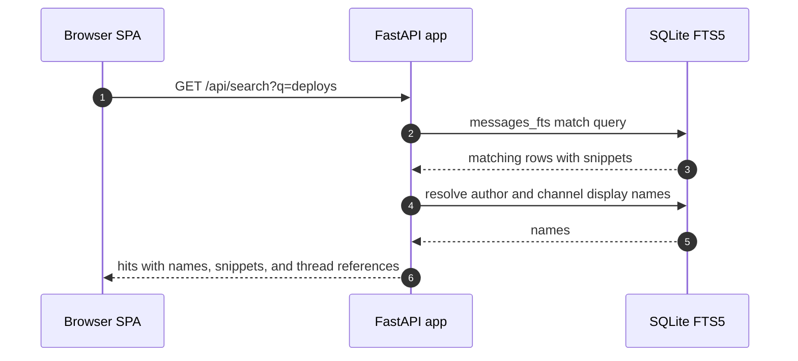
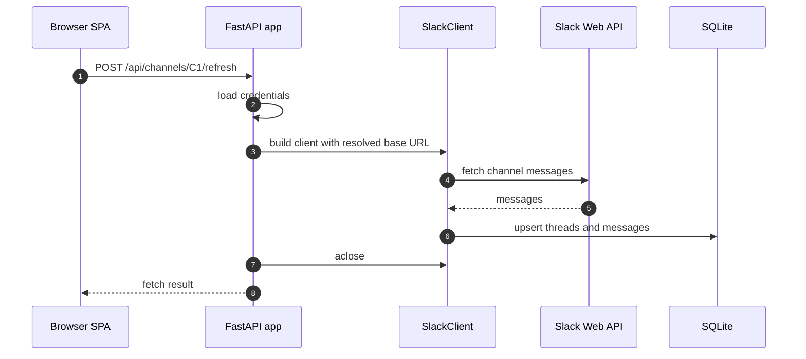
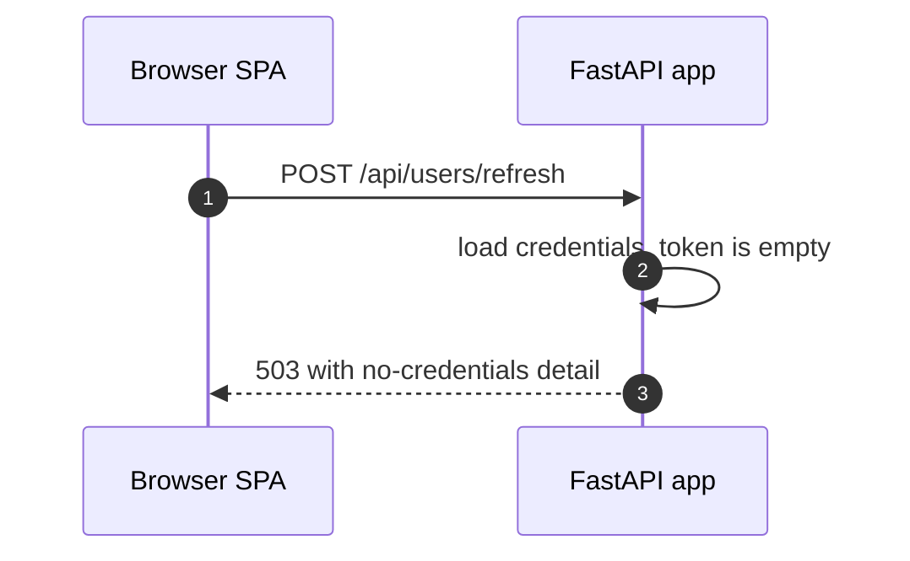

# Specification: Web UI and HTTP API

## Overview

`slackx.server.app.create_app` builds a FastAPI application from a cache database path.
The app exposes a read-mostly JSON API over the local SQLite cache, a small set of read-marker write routes, and POST refresh routes that run the same fetch functions as the CLI.
A single-page application served from `server/static` (built from `web/dist`) consumes the JSON API, and `slackx.cli.commands.serve.serve` runs the app with uvicorn.

## Architecture

The SPA is served as static assets; the client reads the URL path and calls the JSON API.
Refresh routes build a `SlackClient` with the same credential resolution as the CLI, run one cache fetch, then close the client.

## Data Models

### Summary payload

| Field | Type | Constraints | Description |
|---|---|---|---|
| db_path | string | not null | Absolute path of the cache database |
| users | integer | not null | Cached user count |
| channels | integer | not null | Cached channel count |
| messages | integer | not null | Cached message count |
| threads | integer | not null | Cached thread count |

### User payload

| Field | Type | Constraints | Description |
|---|---|---|---|
| id | string | not null | Slack user id |
| name | string or null | | Slack handle |
| real_name | string or null | | Profile real name |
| display_name | string | not null | `real_name (name)`, or the real name, name, or id |
| is_bot | boolean | not null | Bot account flag |
| tz | string or null | | Profile timezone |
| title | string or null | | Profile title |
| avatar | string or null | | Best available profile image URL, largest first |

### Channel summary payload

| Field | Type | Constraints | Description |
|---|---|---|---|
| id | string | not null | Channel id |
| name | string or null | | Channel name, null for direct messages |
| display_name | string | not null | Resolved name, direct-message peer name when applicable |
| is_im | boolean | not null | Direct-message flag |
| is_private | boolean or null | | Private channel flag |
| message_count | integer | not null | Cached message count |
| thread_count | integer | not null | Cached thread count |

### Channel view payload

| Field | Type | Constraints | Description |
|---|---|---|---|
| id | string | not null | Channel id, echoed when the channel row is absent |
| name | string or null | | Channel name |
| display_name | string or null | | Resolved display name |
| is_im | boolean | | Direct-message flag |
| is_private | boolean or null | | Private channel flag |

### Message payload

| Field | Type | Constraints | Description |
|---|---|---|---|
| ts | string | not null | Message timestamp |
| user | string or null | | Author user id |
| text | string or null | | Message text |
| user_name | string or null | | Resolved author display name |
| reply_count | integer | | Reply count for channel root messages |
| latest_reply_ts | string or null | | Newest reply ts for channel root messages |

Thread messages serialize the same fields without the reply-count fields.

### Search hit payload

| Field | Type | Constraints | Description |
|---|---|---|---|
| channel | string | not null | Channel id |
| channel_name | string | not null | Resolved channel display name |
| channel_is_im | boolean | not null | Direct-message flag |
| thread_ts | string | not null | Thread root ts |
| ts | string | not null | Message ts |
| user | string or null | | Author user id |
| user_name | string or null | | Resolved author display name |
| text | string or null | | Message text |
| snippet | string or null | | FTS5 snippet with match markers |

### ReadMarkerInput (request body for `PUT /api/read`)

| Field | Type | Constraints | Description |
|---|---|---|---|
| reader | string | required, non-empty after trimming | Reader name, for example `web` |
| channel | string | required | Channel id |
| thread_ts | string or null | optional | Thread root ts, null for the channel-level pointer |
| last_read_ts | string or null | optional | Explicit ts, defaults to the newest cached message in scope |

### ReadMarker payload

| Field | Type | Constraints | Description |
|---|---|---|---|
| reader | string | not null | Reader name |
| channel | string | not null | Channel id |
| thread_ts | string or null | | Thread root ts, null for the channel-level pointer |
| last_read_ts | string | not null | Last-read timestamp |
| updated_at | number | not null | Unix time of the last update |

## API Contracts

The request and response schemas are the payloads above; FastAPI generates an OpenAPI document at runtime but none is committed.
The table is the contract summary.

| Method | Path | Purpose |
|---|---|---|
| GET | /api/summary | Workspace counters and database path |
| GET | /api/users | Cached users with display names and avatars |
| GET | /api/channels | Cached channel summaries with counts and display names |
| GET | /api/channels/{channel_id}/messages | Channel root messages newest first, with `before` and `limit` query parameters |
| GET | /api/channels/{channel_id}/threads/{thread_ts} | All cached messages in one thread |
| GET | /api/search | Full-text search with required `q` and bounded `limit` |
| GET | /api/read | List last-read pointers, filtered by `reader` and `channel` |
| PUT | /api/read | Create or advance a last-read pointer |
| DELETE | /api/read/{reader} | Delete a reader's pointers, optionally one channel's via `?channel=` |
| DELETE | /api/read/{reader}/{channel_id} | Delete the channel-level pointer, keeping thread pointers |
| DELETE | /api/read/{reader}/{channel_id}/{thread_ts} | Delete one thread pointer |
| POST | /api/users/refresh | Fetch the workspace user list from Slack |
| POST | /api/channels/refresh | Fetch the workspace channel list from Slack |
| POST | /api/channels/{channel_id}/refresh | Fetch a channel's messages, with `full_threads` and `oldest` |
| POST | /api/channels/{channel_id}/threads/{thread_ts}/refresh | Fetch one thread, with `full` |
| GET | / | Serve the SPA index |
| GET | /archives/{channel_id} | Serve the SPA for a channel deep link |
| GET | /archives/{channel_id}/{message_ref} | Serve the SPA for a message deep link |
| GET | /static/* | Serve the SPA assets |

Error codes shared across endpoints:

| Status | Code | Description |
|---|---|---|
| 404 | not found | Unknown channel on a refresh, no cached messages for a thread, or no cached messages for a read pointer's scope |
| 422 | validation error | Blank reader or a query outside its bounds (`q` shorter than 1, `limit` out of range) |
| 503 | service unavailable | A refresh ran without configured Slack credentials |

A `GET /api/channels/{channel_id}/messages` call for an unknown channel returns 200 with an empty message list and a null channel name, because search can cache messages for a channel whose row was never fetched.

## Sequences

### First load

### Full-text search

### Refresh with credentials

### No-credentials 503

## Technical Decisions

| Decision | Choice | Rationale |
|---|---|---|
| Framework | FastAPI with uvicorn | Async routing, request validation, and static file serving in one dependency already used by the cache layer's async client |
| Database access | One short-lived connection per request, resolved from `app.state.db_path` | Local queries are sub-millisecond and the storage layer is synchronous by design |
| Credential resolution | `load_credentials(require=False)` plus the CLI's client builder | Refresh behaves like the CLI without duplicating credential logic |
| Missing credentials | 503 on refresh, browsing still available | Browsing the cache needs no network, so only refresh is blocked |
| Unknown channel | Refresh returns 404; messages returns 200 with empty data | A channel row may be missing while search has cached its messages |
| Search index | `ensure_search_index` at startup | Databases created before the index existed gain it once, on first serve |
| Deep links | `/archives/{channel_id}[/{message_ref}]` serve the SPA | Slack permalink paths can be pasted after the host and resolved by the client |
| Read marker default | `last_read_ts` defaults to the newest cached message in scope | A browser can mark a channel or thread read without knowing the ts |

## Risks and Unknowns

1. The local server has no authentication, so any local process that can reach the port can read the cache; this is mitigated only by the default 127.0.0.1 bind.
2. Binding the server to a non-localhost host exposes the whole cache with no access control.
3. SQLite queries run on the event loop thread, so a slow query would block other requests; locally the queries are sub-millisecond.
4. The SPA is loaded with Vue from a CDN, so the first browser load needs internet access.
5. `web/dist` is built outside this repository, so a source change cannot be made here.

## Out of Scope

- Authentication, user accounts, or sessions for the server.
- Writing or fetching through the UI beyond the refresh routes.
- A workspace switcher across databases.
- The SPA source code; only the built assets in `web/dist` are served.
