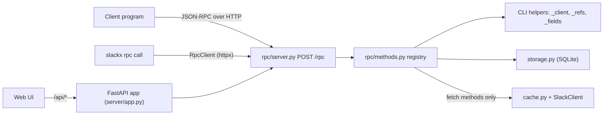

# Specification: JSON-RPC API

## Overview

The JSON-RPC API is a transport layer over the CLI's operations.
`slackx.rpc.server.add_rpc_routes` mounts `POST /rpc` on the FastAPI app built by `create_app`, so `slackx serve` and `slackx rpc serve` expose the API next to the web UI.
`slackx.rpc.methods` holds the method registry, parameter validation, and handlers.
Handlers reuse the CLI helpers (`_client`, `_resolve_target`, `storage`, `cache`) and the shared payload builders in `cli/_internal/_render.py`, so the JSON shapes match `--json`.

## Architecture

The server binds one database path and one Slack API base URL when it starts.
Every handler receives an `RpcContext` with those values and builds a `CommonArgs` with `db` set, so the CLI's workspace resolution returns the bound database without another `auth.test`.

## Transport

`POST /rpc` accepts `application/json`.

| Body | Behavior |
|---|---|
| Single request object | One response object |
| Array of requests | Array of responses, in request order, with notifications omitted |
| Empty array | One `-32600` error object |
| Request object without `id` | Handler runs, HTTP 204, no body |
| Invalid JSON | HTTP 200 with `-32700` |
| Invalid request object | HTTP 200 with `-32600` |

Request-level failures always use HTTP 200, as JSON-RPC 2.0 requires for application and request errors.
HTTP 204 is used only when a batch yields no responses.

## Request validation

`rpc/protocol.py::parse_request` enforces:

| Field | Rule |
|---|---|
| `jsonrpc` | Exactly `"2.0"` |
| `method` | Non-empty string |
| `params` | JSON object or absent; absent becomes `{}`; arrays are rejected |
| `id` | String, number, or null when present; a boolean is rejected |
| `id` presence | Absence marks the request as a notification |

Each handler calls `_check_params(params, allowed)` first, so unknown parameters are `-32602`.
Typed helpers validate strings, booleans, integers, choices, and field lists.

## Errors

| Code | Meaning | Source |
|---|---|---|
| `-32700` | Parse error | Body is not JSON |
| `-32600` | Invalid request | `parse_request` validation, empty batch |
| `-32601` | Method not found | Registry lookup |
| `-32602` | Invalid params | Unknown parameter, wrong type, missing required parameter |
| `-32603` | Internal error | Reserved; not currently emitted |
| `-32000` | Server error | Application failure: missing cache row, no credentials, Slack error, unexpected exception |

`dispatch` converts `SystemExit` from CLI helpers into `-32000` with its message, and any other exception into `-32000` named by exception type.
It logs the failure with structlog and never returns a traceback.

## Method registry

`rpc/methods.py` defines a `Method` dataclass and a `@method(name, description, params)` decorator.
`_METHODS` maps names to handlers, and `list_methods()` returns the catalog sorted by name.
`system.methods` returns that catalog.

Handlers are `async def handler(ctx: RpcContext, params: dict) -> Any`.
Network-touching imports (`cache`, `slack_api`, `workspace`) stay inside handlers or helpers, consistent with the CLI's lazy-import rule.

## Methods

| Method | Parameters (all optional unless noted) | Result |
|---|---|---|
| `system.methods` | none | `{"methods": [{name, description, params}]}` |
| `cache.status` | none | `{workspace, db_path, ...DbStatus}` |
| `cache.clear` | `target`: `all` (default), `messages`, `channels`, `users`, `read` | `{messages, threads, channels, users, read_markers}` |
| `users.list` | `limit` (0), `fields`, `fetch` (true) | `{user_count, users}` |
| `users.get` | `user` (required), `fields`, `fetch` (true) | `{user_count, users}` with one user |
| `channels.list` | `limit` (0), `fields`, `fetch` (true) | `{channel_count, channels}` |
| `channels.get` | `channel` (required), `fields`, `fetch` (true) | `{channel_count, channels}` with one channel |
| `conversations.fetch` | `target` (required), `ts`, `full_threads` (false), `last` (`1d`) | `{kind, ...fetch counts}` |
| `conversations.get` | `target` (required), `ts`, `fetch` (null), `with_thread_message` (false), `last` (`1d`), `reader` (`default`) | Thread or channel payload |
| `conversations.search` | `query` (required), `count` (20), `limit` (200), `sort` (`timestamp`), `sort_dir` (`desc`), `full_threads` (false), `fields` | `{query, match_count, matches, stats}` |
| `read.mark` | `target` (required), `ts`, `reader` (`default`), `last_read` | `{marker}` |
| `read.show` | `reader`, `channel` | `{read_count, markers}` |
| `read.clear` | `reader` (required), `channel`, `ts` | `{deleted}` |

`target` accepts a permalink, a channel id, a channel name (`general` or `#general`), or a user id or `@handle` for that direct message.

### Result payloads

| Payload | Builder | Keys |
|---|---|---|
| Thread | `_thread_payload` | `channel`, `channel_name`, `thread_ts`, `message_count`, `messages` |
| Channel | `_channel_payload` | `channel`, `channel_name`, `message_count`, `messages` |
| Search | `_search_payload` | `query`, `match_count`, `matches`; the RPC adds `stats` |
| Users | `_users_payload` | `user_count`, `users` |
| Channels | `_channels_payload` | `channel_count`, `channels` |

The CLI JSON renderers call the same builders, so the two surfaces cannot drift.

## Fetch policy

`conversations.get` mirrors the CLI:

| `fetch` | Behavior |
|---|---|
| absent / null | Fetch only when the target is not cached |
| `true` | Always refresh |
| `false` | Never fetch |

`users.list`, `channels.list`, `users.get`, and `channels.get` use `fetch: true` by default and fetch only when the cache has no rows (list) or the entity is missing (get).

`cache.clear` never prompts.
The RPC call is the explicit action; there is no interactive terminal to confirm on.

## CLI

| Command | Behavior |
|---|---|
| `slackx rpc serve` | Starts the same uvicorn app as `slackx serve` |
| `slackx rpc methods` | Calls `system.methods` and prints a human list, or JSON with `--json` |
| `slackx rpc call METHOD` | Calls a method and prints pretty JSON; `--compact` prints one line |

`rpc call` accepts `--params JSON` or `--params-file PATH` (`-` reads stdin).
The endpoint is `--url`/`--server`, then `SLACKX_RPC_URL`, then `http://127.0.0.1:8280/rpc`.
JSON-RPC errors go to stderr and exit 1; malformed local parameters exit 2.

## Python client

`slackx.rpc.client.RpcClient` wraps an `httpx.AsyncClient`.
`call(method, params)` assigns an incrementing id, posts the request, raises `RpcError` for an error object, and raises `RpcTransportError` for connection, HTTP, or invalid-JSON failures.
`methods()` is a convenience over `system.methods`.
The client owns its transport unless one is injected, and supports `async with`.

## Security

- No authentication is added; the server binds to loopback by default, matching the existing web UI.
- The client cannot choose the database, workspace, or Slack base URL.
- Credentials stay in the server process's environment or config file.
- `SLACK_TOKEN` and cookies are never included in a response.

## Decisions

- JSON-RPC over HTTP on the existing FastAPI app, rather than a separate server, so the web UI and API share one process and one database connection policy.
- Typed methods per CLI operation, rather than one `cli.run(argv)` passthrough, so clients get structured results and stable error codes instead of rendered text.
- Results reuse the CLI's JSON payload builders, so `--json` and RPC stay aligned.
- Parameter objects only, so validation is uniform and unknown options are caught.
- Long-running commands (`poll`, `serve`) stay out of the request/response surface.
- No new dependency: the transport is FastAPI, and the client uses httpx, both already required.
